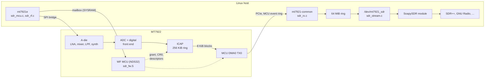

# mt7922-sdr

Raw IQ capture from the MediaTek MT7922 (PCI `14c3:0616`, sold as the AMD RZ616) WiFi 6E
adapter, exposed as a character device and a SoapySDR source.

The vendor firmware is not loaded. A small NDS32 program is downloaded through the boot ROM
instead. It powers up the WF PHY, configures the in-chip capture block (ICAP), and streams
its ring buffer to the host over the existing MCU event DMA path. The host side is a patch to
the upstream `mt7921e` driver.

Tested on a Framework Laptop 16 (AMD Ryzen 7040 Series) with Linux 7.2.

https://github.com/user-attachments/assets/e588e4c8-e7f4-4daa-860c-82df044ef805

| | |
|:--|:--|
| Band | 2.4 GHz, tunable 2390 to 2500 MHz |
| Sample rates | 40, 80 MSps continuous; 160 MSps gapped (PCIe 2.0 x1 limit) |
| Format | 14-bit I/Q in 32-bit words (12 significant bits) |
| Gain | PHY AGC, or manual LNA (0..4), LPF (0..9), digital (-32..31) |
| Host interface | `/dev/mt7921_sdr` (read + ioctl), SoapySDR module `mt7922` |

> **Warning.** This replaces the WiFi firmware while it runs and writes analog front-end
> registers with values read from the vendor firmware on one specific die. The driver refuses
> to write anything unless the die ID and crystal trim match the device the tables came from
> (see [docs/quirks.md](docs/quirks.md#identity-gate)). Every register it writes is restored
> when the module is removed.

## How it fits together



The host owns the A-die (through a host-visible SPI bridge) and the mailbox. The MCU owns
everything the host cannot reach: the PHY registers at `0x83xxxxxx`, the ICAP grant at
`0x88009004`, and the device side of the DMA engine.

## Quick start

Requirements: kernel headers and the `drivers/net/wireless/mediatek/mt76` source for the
running kernel; an NDS32 binutils build (`nds32le-elf-as`, `-ld`, `-objcopy`); Python 3. For
the plugin: SoapySDR and CMake. For the check script: numpy.

```sh
tools/build.sh /path/to/linux/drivers/net/wireless/mediatek/mt76
sudo tools/sdr-up.sh               # WiFi and Bluetooth go away, /dev/mt7921_sdr appears
tools/sdr_check.py                 # rates, retune, gain, 802.11b beacon detection

cmake -S soapy -B build/soapy && cmake --build build/soapy
SOAPY_SDR_PLUGIN_PATH=$PWD/build/soapy SoapySDRUtil --find=driver=mt7922

sudo tools/sdr-down.sh             # registers restored, WiFi and Bluetooth back
```

`build.sh` copies the mt76 tree to `build/`, applies `driver/mt76-sdr.patch`, adds the SDR
sources, assembles the firmware into `sdr_fw.h`, and builds `mt7921-common.ko` and
`mt7921e.ko` as external modules. Nothing is installed.

## Repository layout

```
driver/
  mt76-sdr.patch       hooks into upstream mt7921 (6 files, 20 lines)
  sdr.h                interface between mt7921-common and mt7921e
  sdr_rx.c             mt7921-common: "sdr" parameter, sample event consumer
  sdr_internal.h       state, register addresses, prototypes
  sdr_mcu.c            boot from ROM, mailbox commands, bring-up order
  sdr_rf.c             A-die bridge, undo log, stock state replay, tune, rate, gain
  sdr_stream.c         /dev/mt7921_sdr, stream start/stop, teardown
  sdr_stock_2g.h       vendor A-die state: 2.4 GHz band and channels 1..13
  mt7921_sdr_ioctl.h   user API
firmware/
  sdr_fw.S             the MCU program (ops command, stream command)
  build_fw.py          assembler driver, PDA checksum, header generator
soapy/                 SoapySDR module
tools/                 build, up/down, end-to-end check
docs/                  see below
LICENSE                which licence covers which path
LICENSES/              full texts: BSD-3-Clause-Clear, MIT
```

## Documentation

| Document | Contents |
|:--|:--|
| [architecture.md](docs/architecture.md) | Components, address spaces, who owns what |
| [bringup.md](docs/bringup.md) | Boot and bring-up, step by step, with the code for each step |
| [streaming.md](docs/streaming.md) | Stream command, event format, flow control, stop handshake |
| [rf.md](docs/rf.md) | Stock state replay, tuning, sample rate and filter width, gain |
| [teardown.md](docs/teardown.md) | Stop, undo log, module removal, recovery |
| [registers.md](docs/registers.md) | Register and mailbox reference |
| [quirks.md](docs/quirks.md) | Hardware quirks and lessons learned, with evidence |

## Status and limitations

- 2.4 GHz only. The A-die state is replayed from vendor readbacks; 5 and 6 GHz need their
  own tables (the method is in [rf.md](docs/rf.md#where-the-tables-come-from)).
- One chain (chain 0). One reader at a time.
- 160 and 320 MSps exceed the PCIe 2.0 x1 link; the stream restarts after each overrun.
- WiFi and Bluetooth are unavailable while SDR mode is loaded.
- Tables were captured on one device. The identity gate keeps them off other dies, but other
  MT7922 units with the same die ID have not been tested.

## Credits

- [BirriaSDR](https://github.com/luigifcruz/BirriaSDR) (Luigi Cruz): the approach of
  booting a custom program on the MT7961 MCU, the PDA download checksum, the A-die SPI bridge,
  and the ICAP capture configuration.
- [w1700k-sdr](https://github.com/h0m3us3r/w1700k-sdr): MT7996 ICAP CR0/CR10 bit maps and
  the PHY gain register layout, which match the MT7922.
- [openwrt-one-sdr](https://github.com/alphafox02/openwrt-one-sdr): MT7915 ICAP patch, used
  as a cross-reference.
- The upstream mt76 driver, which this patches.

## License

Copyright (c) 2026 unstablerobotgf. The kernel driver (`driver/`) is BSD-3-Clause-Clear,
matching the mt76 driver it extends; everything else is MIT. Portions derive from mt76
(MediaTek) and BirriaSDR (Luigi C.), whose notices are kept. Each file carries an SPDX tag;
see [LICENSE](LICENSE) and the texts in [LICENSES/](LICENSES/).
