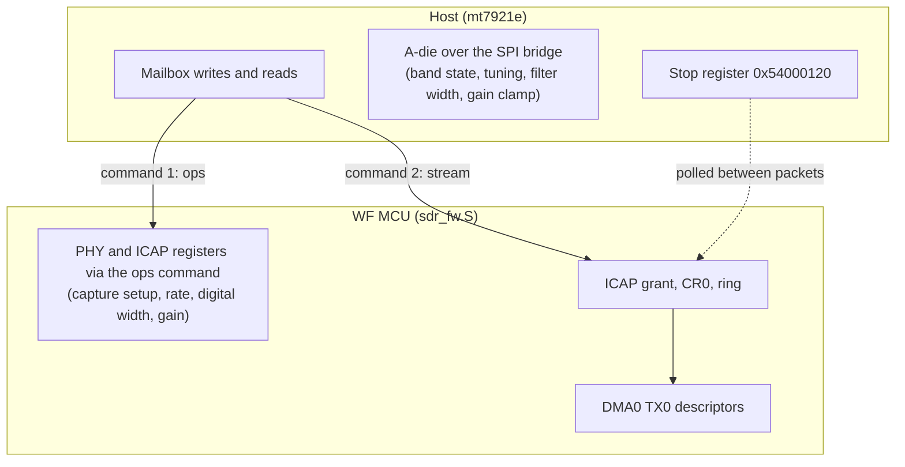

# Architecture

## Why a custom MCU program

The MT7922 receive chain already contains everything an SDR needs: a wideband analog front
end, ADCs running at up to 320 MSps, and ICAP, a capture block that writes raw ADC samples
into an on-chip ring. The vendor firmware uses ICAP for calibration and diagnostics but
offers no streaming interface to it.

Two things block a host-only approach:

1. The PHY registers (`0x83xxxxxx`) and the ICAP grant (`0x88009004`) are not reachable
   through BAR0. Only the WF MCU can write them.
2. While ICAP owns the SYSRAM bus (the grant is held), SYSRAM is unreadable from the host,
   and touching the ICAP ring after the grant is released can take the whole WF bus down
   until the next reboot (see [quirks.md](quirks.md#wf-bus-death-after-grant-release)).

So the MCU runs a program of ours. It is downloaded by the boot ROM exactly like vendor
firmware (the ROM's patch download and `FW_START` commands), with no vendor ROM patch loaded.
It calls one ROM function to power up the WF PHY, then serves two mailbox commands.

## Components

| Piece | Runs on | Role |
|:--|:--|:--|
| `firmware/sdr_fw.S` | WF MCU | PHY power-on, register ops for the host, the stream loop |
| `driver/sdr_mcu.c` | host, `mt7921e` | Download and boot, mailbox commands, bring-up order |
| `driver/sdr_rf.c` | host, `mt7921e` | A-die access, undo log, tuning, rate and filter width, gain |
| `driver/sdr_stream.c` | host, `mt7921e` | Character device, stream start/stop, teardown |
| `driver/sdr_rx.c` | host, `mt7921-common` | Consume sample events from the MCU event ring |
| `soapy/` | user space | SoapySDR device `driver=mt7922` |

`sdr_rx.c` lives in `mt7921-common` because MCU events are dispatched from
`mt7921_mcu_rx_event()` in `mcu.c`, which is part of that module.

## Address spaces

| Address | Host access | Contents |
|:--|:--|:--|
| `0x00407c00` | BAR0 `0x87c00` (fixed map) | Mailbox, in WF MCU SYSRAM |
| `0x0091b000` | none (download only) | Program image, ILM |
| `0x02042000` | none | Program's DMA descriptors, event headers, stream variables (data RAM) |
| `0x54000000` | BAR0 `0x02000` | MCU DMA0 (device side of WFDMA PCIE0); `0x54000120` is the stop register |
| `0x7c004000` | BAR0 (CONN_INFRA map) | A-die SPI bridge |
| `0x80021090` | MCU only | ICAP CR0..CR10 |
| `0x83000000` | MCU only | PHY: per-chain CSD (`+ chain << 16`), digital front end (`0x8308xxxx`, `0x8309xxxx`, `0x830axxxx`) |
| `0x88009004` | MCU only | ICAP grant, bits 27:24 |
| `0xe0200000` | MCU only | ICAP ring, 256 KiB |

The program keeps all state it needs while streaming in data RAM (`0x0204xxxx`), because
SYSRAM, and with it the mailbox, disappears from the bus while the grant is held.

## Ownership

The rule that keeps the device alive: **the host never touches anything that needs the MCU
while the MCU is streaming**. Tuning only uses the SPI bridge, so it is allowed during a
stream. Gain and rate changes need PHY writes, so the driver stops the stream around them.

## Upstream hooks

`driver/mt76-sdr.patch` is the only change to upstream files:

| File | Change |
|:--|:--|
| `Makefile` | Build the four SDR sources |
| `mt7921.h` | Include `sdr.h` |
| `init.c` | With `sdr=1`, `init_work` boots the MCU once and skips mac80211 registration |
| `mcu.c` | Offer each MCU event to `mt7921_sdr_rx()` first |
| `pci.c` | 512-entry MCU RX ring in SDR mode; call `mt7921e_sdr_shutdown()` on remove |
| `pci_mcu.c` | `mt7921e_mcu_init()` boots the SDR program instead of the vendor firmware |

Everything is gated on the `sdr` module parameter of `mt7921-common`; with it unset the
driver behaves exactly as upstream.
