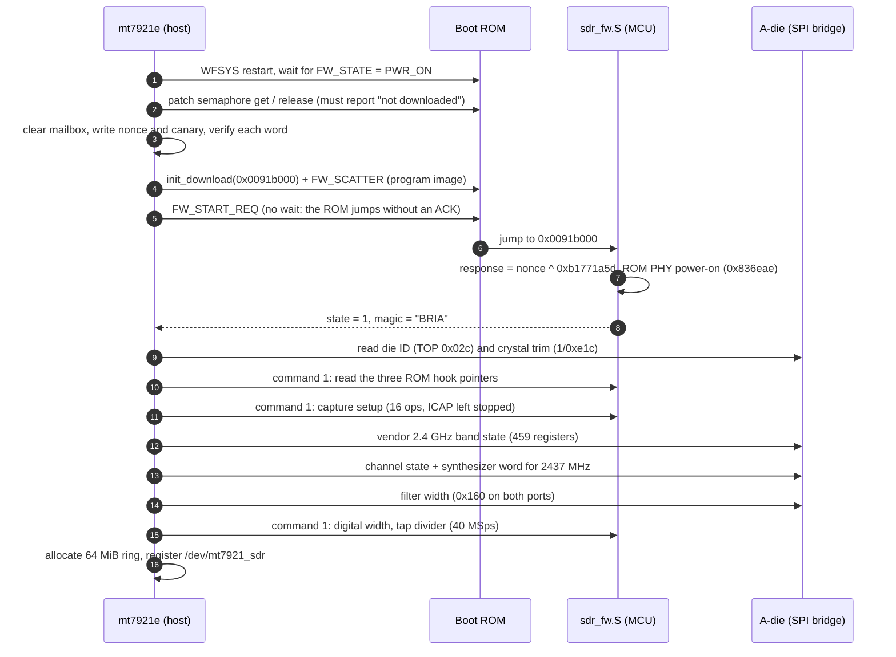

# Boot and bring-up

Everything here runs once, from the driver's `init_work`, when `mt7921-common` is loaded with
`sdr=1`. The entry point is `mt7921e_sdr_boot()` in `driver/sdr_mcu.c`.

## 1. Reset the MCU and check the ROM is clean

`mt76_connac_mcu_restart()` resets WFSYS. The driver then waits for `MT_TOP_MISC2_FW_PWR_ON`
in `MT_CONN_ON_MISC`, the same state the stock driver waits for before a patch download.

The patch semaphore must answer `PATCH_NOT_DL_SEM_SUCCESS`. Any other answer means a vendor
ROM patch is still resident. The patch hooks ROM functions, and this program calls ROM
functions (PHY power-on, the grant hooks), so a resident patch would change what they do.
In that case the driver refuses to boot. In practice the semaphore has always reported "not
downloaded" after the WFSYS reset done on module load; a cold boot certainly clears it.

## 2. Prepare the mailbox

The mailbox is the first 0x400 bytes at `0x00407c00` in SYSRAM, reachable from the host at
BAR0 `0x87c00` through mt7921's fixed map. Before the download the driver writes the first 64
words, reads each one back, and fails if any differs. This proves SYSRAM is host-reachable
before anything else depends on it.

Three words are non-zero:

| Offset | Value | Purpose |
|:--|:--|:--|
| `+0x04` | random nonce | Proves the program that answers is the one just loaded |
| `+0x4c` | `0xa5a5a5a5` | Replaced by the PHY power-on return value |
| `+0xbc` | `0x5a17c0de` | Canary; the program never writes it (see step 7 of streaming) |

## 3. Download and start

`mt76_connac_mcu_init_download()` and `mt76_mcu_send_firmware(FW_SCATTER)` move the image to
ILM at `0x0091b000`. The image is the assembled program, padded to 16 bytes, plus 16 bytes of
trailer whose last word makes the ROM's PDA checksum come out to zero (`checksum()` in
`firmware/build_fw.py`). After the transfer `0x54000808` reads `0x25` when the ROM accepted
it.

`FW_START_REQ` with `FW_START_OVERRIDE` and the entry address starts the program. The ROM
jumps immediately and never sends the response a vendor firmware would, so the command is
sent with `wait_resp = false`. The driver then polls the mailbox magic for up to 3 s.

## 4. Program start-up (`_start` in `sdr_fw.S`)

1. Write `nonce ^ 0xb1771a5d` to `+0x08`.
2. Set state `0x10` and call the ROM's WF PHY power-on at `0x836eae`. Store its return value
   at `+0x4c`.
3. Set state `1` and publish the magic `0x41495242` at `+0x00`, last.
4. Loop on `+0x3c` (command), incrementing `+0x34` on every pass so the host can see the
   program is alive.

The driver accepts the boot only if magic, response and state all match.

## 5. Identity gate

Before writing anything, `sdr_bringup()` reads two A-die values over the SPI bridge:

| Register | Expected | Meaning |
|:--|:--|:--|
| TOP (port 5) `0x02c` | `0x79228a00` | Die ID |
| Port 1 `0xe1c` bits 9:0 | `0xd4` | Crystal trim selection: 40 MHz (`0x113` would be 52 MHz) |

The stock register tables and the synthesizer formula were measured on a die and crystal
matching these. On a mismatch the driver stops with no writes done.

## 6. ROM hook check

The vendor firmware calls two ROM function pointers, `*(0x821b4c)` and `*(0x821b50)`, with
the enable state around every grant change, and polls the ROM status function `*(0x821b7c)`
before releasing the grant. The program does the same. These pointers live in RAM, so the
driver reads all three through command 1 and refuses to continue unless each one points into
ROM (`0x800000..0x83ffff`). With no vendor patch loaded they always have; the check guards
against calling into whatever a future ROM revision or a resident patch left there.

## 7. Capture setup (command 1)

`sdr_capture_ops[]` is applied in one command. The program writes each op's index to
`+0x2a0` before touching the address, so if a write ever hangs the bus, the mailbox names
the register responsible.

| Address | Change | Purpose |
|:--|:--|:--|
| `0x80021090` | `= 0xf1` | ICAP CR0, not running |
| `0x80021098` | `= 0` | CR2 ring start |
| `0x8002109c` | `= 0xfffc` | CR3 ring end (256 KiB) |
| `0x800210b8` | `[19:16] = 0, |= 0x9c000000` | CR10: plain 32-bit words, no packing |
| `0x83080004/8` | `|= 0x3840` | Chain 0 PHY clock gates |
| `0x83090004/8` | `|= 0x3840` | Chain 1 PHY clock gates |
| `0x830ad440` | `[7:0] = 0x13, |= 0x80000000` | Capture source: dense ADC samples |
| `0x830ad448` | `[27:0] = 0x08c0400` | Tap 4 (chain 0), divider 3 (40 MSps) |
| `0x830a1000/4/8`, `0x830a3008` | BirriaSDR values | Front-end routing to ICAP |
| `0x820e3000` | `[9] = 0, [8] = 1` | Receive-only MAC clocks |
| `0x80021090` | `= 0x4f1` | Stopped, cursor reset |

Every op's "before" value goes into the undo log.

The ICAP grant is deliberately not part of setup. The stream command takes it at the start
of a stream and releases it at the end; see [quirks.md](quirks.md#wf-bus-death-after-grant-release).

## 8. Analog state (`sdr_rf.c`)

1. `sdr_rf_stock_band()` writes the vendor firmware's own 2.4 GHz A-die state, 459 registers
   read back from a stock driver tuned to 2437 MHz.
2. `sdr_rf_tune(2437 MHz)` writes the per-channel registers for the nearest channel, then
   the exact synthesizer word.
3. `sdr_rf_rate(40)` sets the analog filter width on both bridge ports, the digital filter
   class on both chains, and the tap divider.

[rf.md](rf.md) explains each of these. No VCO calibration is run: the replayed state already
contains the vendor's calibration results.

## 9. Service

`sdr_service_setup()` allocates the 64 MiB host ring, publishes it to the RX path, and
registers `/dev/mt7921_sdr` (mode 0666, one opener at a time). The radio is now configured
for 2437 MHz at 40 MSps and idle; ICAP does not run until a reader issues `MT7921_SDR_START`.

If any step from 7 on fails, `sdr_bringup()` replays the undo log before returning, so a
failed bring-up leaves the A-die and PHY as the vendor firmware left them.
