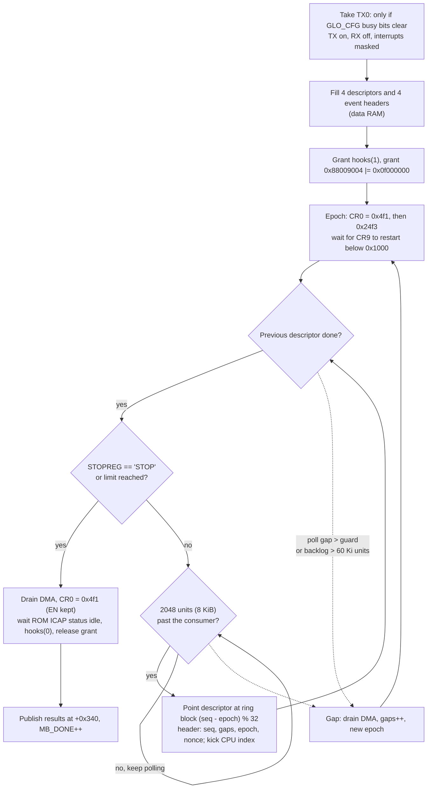
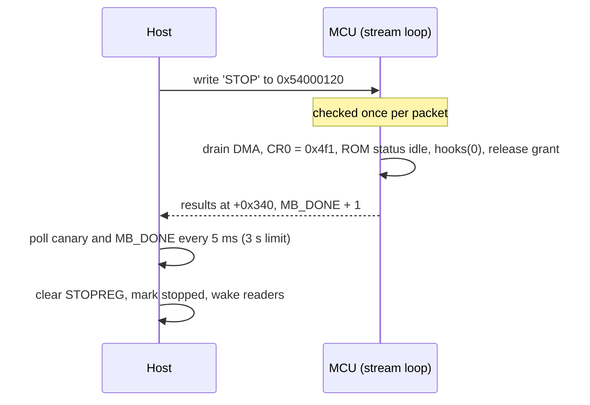

# Streaming

A stream is one invocation of mailbox command 2. It holds the ICAP grant from start to
finish, runs ICAP circularly over its 256 KiB ring, and sends the ring to the host 8 KiB at a
time as MCU events on DMA0 TX0. The host's existing MCU event RX path receives them.

## Start (`sdr_stream_start()`)

1. Apply the requested rate (`sdr_rf_rate()`) and, if the frequency changed, tune.
2. Reset the host ring and RX counters, clear the stop register `0x54000120`.
3. Write the packet limit (0 = until stopped) and the poll guard to the mailbox.
4. Record the current `MB_DONE`, mark the stream running, write command 2.

From here until the program finishes, SYSRAM is not readable and the host does not issue
mailbox commands.

## The stream loop (`stream:` in `sdr_fw.S`)

### Flow control without a hardware read pointer

ICAP has no notion of a consumer; it overwrites the ring at the ADC rate. The program keeps
two counts in data RAM:

- **produced**: CR9 (the write cursor, 16 bits, in 4-byte units) is sampled on every poll and
  its forward distance, mod 65536, is added up.
- **consumed**: 2048 units for every descriptor the DMA engine has finished.

A packet is sent only when `produced - consumed >= 2048`, so the DMA never reads a block
ICAP has not finished. If the backlog reaches 61440 units (4 Ki units short of the 64 Ki-unit
ring) ICAP is about to lap the DMA. If the time between two polls exceeds the guard (half a
ring time: 750 us at 40 MSps), the program cannot prove it did not lap. Either case is a
**gap**: the program drains the in-flight descriptor, increments the gap counter, and
restarts ICAP at ring offset 0 with a new epoch. The host sees a gap as a jump in the
header's gap count, never as corrupted samples.

At 40 and 80 MSps the stream runs without gaps. At 160 MSps the 5 GT/s x1 link (about
373 MB/s usable here, against 640 MB/s produced) cannot keep up and the stream is gapped:
roughly 58 % of the samples arrive, in contiguous runs.

### One descriptor in flight

The program keeps exactly one descriptor outstanding, so "consumed" is always exact: a block
counts as read only once the DMA index shows it done. This is a design choice for simple,
provable accounting rather than a measured limit. One in flight sustains 80 MSps (320 MB/s)
without gaps, so deeper queueing has not been needed.

## Event format

Each event is a connac2 MCU RX descriptor followed by the samples:

| Offset | Size | Contents |
|:--|:--|:--|
| 0 | 4 | `0x3800002c + 0x2000`: length and type bits the host's event path accepts |
| 8 | 4 | Gap count since the stream started |
| 12 | 4 | Sequence number at which the current epoch began |
| 24 | 4 | `0x38000014 + 0x2000` |
| 28 | 1 | EID `0xed` |
| 32 | 1 | Extended EID `0xf5` |
| 36 | 4 | Sequence number |
| 40 | 4 | Nonce from boot |
| 44 | 8192 | 2048 sample words |
| 8236 | 4 | Trailing word (DMA length granularity; ignored) |

The DMA descriptor uses two segments: the 44-byte header from data RAM and the payload
directly from the ICAP ring at `0xe0200000 + 8 KiB * ((seq - epoch) % 32)`. No copy is made
on the MCU.

The header values at offsets 0 and 24 were found empirically: they make the host's
`mt76` MCU RX path accept the buffer as an event. Their individual bit meanings are not
decoded.

An 8 KiB event spans five 2 KiB host RX buffers, and at 40 MSps about 20 000 arrive per
second, so the patch raises the MCU RX ring from its default to 512 entries in SDR mode.

## Host side

`mt7921_sdr_rx()` (`sdr_rx.c`) sees each MCU event before the normal handler. If EID and
extended EID match, it checks length, nonce and sequence, records the device gap count, and
copies the payload into the 64 MiB ring. If the ring has no room for a whole payload, the
payload is dropped and counted (`drops` in `MT7921_SDR_INFO`); partial payloads are never
written.

The ring is single-producer (NAPI context) and single-consumer (`read()`), with free-running
32-bit head and tail byte counters published with acquire/release ordering.

`read()` blocks until data is available or the stream stops, and returns whole 32-bit words.
After `MT7921_SDR_STOP` it keeps returning buffered data, then 0.

## Stop (`sdr_stream_stop()`)

`0x54000120` is `MT_WFDMA_DUMMY_CR`, a scratch register in the DMA block. It is writable by
the host and readable by the MCU while the grant is held, which SYSRAM is not.

While waiting, the host reads `MB_DONE`, `MB_STATE` and then the canary at `+0xbc`. Under
the grant, SYSRAM reads return a stale bus value rather than faulting, so a matching canary
read after the other two is what makes them trustworthy.

### Stream results (`+0x340`)

| Offset | Contents |
|:--|:--|
| `+0x340` | Packets sent |
| `+0x344` | Gaps |
| `+0x348` | Largest backlog seen, units |
| `+0x34c` | Longest poll interval, us |
| `+0x350` | End state: 1 stopped, 2 limit, 4 DMA timeout, 6 TX0 was busy, 10 ICAP never restarted |
| `+0x354` | MCU DMA error register `0x54000110` |
| `+0x358` | Duration, us |
| `+0x35c` | Units produced in the last epoch |

## Changes during a stream

| Operation | Needs the MCU | Behaviour while streaming |
|:--|:--|:--|
| `MT7921_SDR_TUNE` | no (SPI bridge only) | Applied live |
| `MT7921_SDR_GAIN` | yes (PHY registers) | Stream stopped, gain applied, stream restarted |
| rate change | yes | Application stops and restarts with the new rate |
