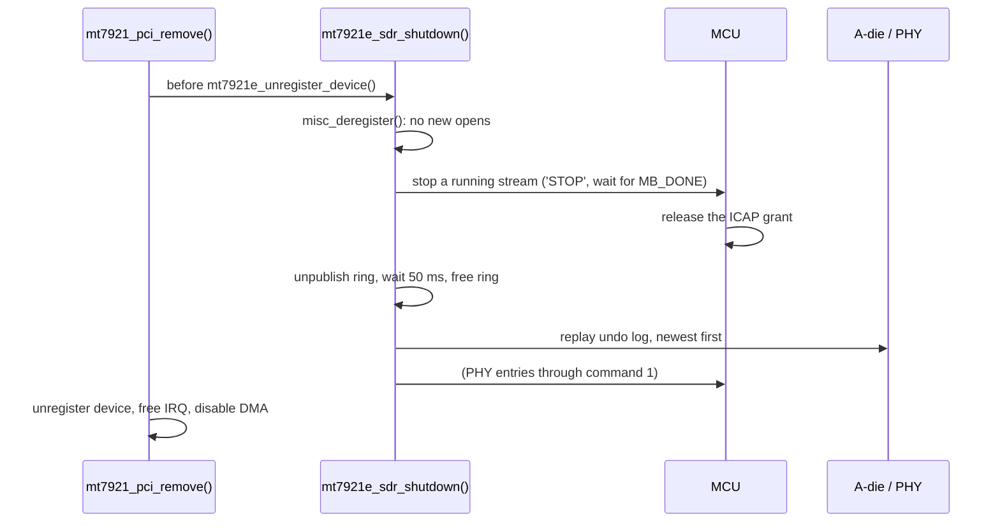

# Teardown

SDR mode is left by removing the modules: `tools/sdr-down.sh` runs
`rmmod mt7921e mt7921_common`, then loads the stock driver and Bluetooth again.

`rmmod` fails while a program holds `/dev/mt7921_sdr` open, because the character device
holds a reference on `mt7921e`. Close the SDR application first.

## Order of operations



The call sits in `mt7921_pci_remove()` before `mt7921e_unregister_device()` because the
stream DMAs into the host's MCU RX ring. Stopping it after the host rings are torn down would
let the MCU write into freed DMA memory.

The 50 ms wait after unpublishing the ring covers an RX NAPI pass that had already loaded the
ring pointer before it was cleared.

## The undo log

Every register write made in SDR mode goes through one of two helpers:

- `sdr_rf_wr()` for the A-die: reads the register over the bridge, records it, writes.
- `sdr_phy_upd()` and `sdr_mcu_ops()` for PHY and ICAP registers: the program reports the
  value it found, which is recorded.

Only the first value seen for each register is kept, so a register written many times (the
synthesizer during retunes) is restored to its value from before SDR mode. On teardown the log
is replayed newest first. A-die entries go over the bridge from the host; PHY entries go
through command 1. If one MCU op times out, the remaining MCU entries are skipped rather than
each waiting for its own timeout, and the count of failures is logged:

```
sdr: undo: restored 470 rf, 36 mcu registers, 0 failed
```

The log holds 1024 entries. If it ever fills, the write that would overflow it is refused
and the operation fails, so nothing is written that cannot be restored.

## Why restore at all

The A-die, TOP and CONN_INFRA blocks are not reset by the WFSYS reset that the stock driver
performs when it loads. Early experiments that left modified state behind made the stock
firmware reload fail and kept Bluetooth from coming back until a reboot. With the undo log in
place the stock driver and Bluetooth return immediately after `sdr-down.sh`.

## Recovery

| Symptom | Meaning | Action |
|:--|:--|:--|
| `rmmod` reports the module in use | `/dev/mt7921_sdr` is open | Close the application |
| `stream did not stop: grant may still be held` | The program stopped answering during a stream | Teardown continues; MCU undo entries will fail. Reboot to be sure the A-die is clean |
| Undo reports failed entries | Some registers kept SDR values | A cold boot resets them |
| `ROM patch present or semaphore busy` on `sdr-up.sh` | Vendor patch still resident | Run `sdr-down.sh` and `sdr-up.sh` again, or cold boot |
| WiFi interface does not return | Stock firmware load failed | Check `dmesg`; a cold boot recovers |
